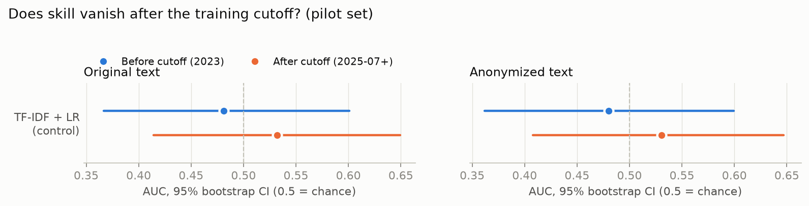

# No Peeking

**Do LLMs predict how markets react to company news, or do they just remember?**
No Peeking is a self-refreshing benchmark of SEC 8-K filings paired with the market reaction that followed, plus
a recipe to post-train small LLMs (0.5B-1.5B, free GPUs) to reason about those filings without seeing the future.



* **Impossible to memorize by construction**: the test set only contains filings published after the models'
  training cutoff, and a monthly job appends new ones.
* **Look-ahead probe for any model**: `nopeeking probe <hf-model>` compares skill before vs. after the cutoff, on
  original vs. anonymized text (difference-in-differences, bootstrap CIs).
* **Post-training study**: hindsight rationales (a teacher sees the outcome, writes pre-outcome reasoning), SFT, DPO
  and GRPO with market-grounded, proper-scoring rewards. Calibration is a first-class metric.

> Research code. Nothing here is financial advice.

## 30-second quickstart

```bash
pip install -e .                       # add ".[llm]" for the probe, ".[train]" for post-training
echo 'NOPEEKING_SEC_USER_AGENT=Your Name your@email' > .env   # SEC asks bots to declare a contact
nopeeking -v data build --config configs/pilot.yaml           # ~500 filings, cached, polite (<= 8 req/s)
nopeeking baselines --config configs/pilot.yaml
nopeeking probe Qwen/Qwen2.5-0.5B-Instruct --config configs/pilot.yaml   # GPU recommended
nopeeking report --config configs/pilot.yaml                  # tables, hero figure, LaTeX macros, this README
```

Full reproduction on free GPUs: [`notebooks/kaggle_reproduce.ipynb`](notebooks/kaggle_reproduce.ipynb).

## The dataset: NoPeek-8K

| | |
|---|---|
| Source | SEC EDGAR 8-K filings (+ Exhibit 99.1 press releases), S&P 500 + S&P 400 firms, 2018 to today |
| Events | item 2.02 earnings, 1.01/2.01 deals, 5.02 executive changes, 8.01 other (priority in that order) |
| Event day `t` | first trading session whose 16:00 ET close is after the EDGAR acceptance timestamp |
| Target | sign of the 3-day return over sessions [t, t+2] minus SPY's (also 1-day and terciles) |
| Splits | train 2018-22, pre-cutoff test 2023, val 2024, embargo 2025-H1, **post-cutoff test 2025-07+** |
| Hygiene | one filing per firm-day, exact-text dedup, missing prices dropped, winsorized returns (train cut-offs), every filter logged with counts |
| Shipped | filing text + derived labels only. Raw prices are never redistributed; scripts rebuild them |

Pre-registered comparisons: [`PREREGISTRATION.md`](PREREGISTRATION.md).

## Results

Everything between the markers below is generated by `nopeeking report` from files in `results/`.
No number in this README is typed by hand. **Current results are from the 493-filing pilot: a pipeline check
with wide intervals, not a finding.**

<!-- RESULTS:START -->
<!-- generated by `nopeeking report --config ...`; do not edit -->

Dataset `pilot`: 493 filings, 2018-01-09 to 2026-11-20. Split sizes: train 248, test_pre 96, val 50, test_post 99.

**Filter log**

| step | before | after | note |
|---|---:|---:|---|
| universe firms (unique CIK) |  | 500 | sp500 |
| sampled firms |  | 80 | seed=0 |
| 8-K filings in date range |  | 9926 | 2018-01-01..2026-11-25 |
| event type in scope (items 2.02/1.01/2.01/5.02/8.01) | 9926 | 7828 |  |
| inside a split window | 7828 | 7316 | drops the embargo gap between val and test_post |
| prices available for full label window | 7316 | 7307 | needs close(t-1)..close(t+2); recent filings wait for their window |
| one filing per firm and event day | 7307 | 7137 | keeps highest-priority event type |
| quota sample per split | 7137 | 500 | {"train": 250, "test_pre": 100, "val": 50, "test_post": 100} |
| filing text fetched | 500 | 500 | 0 fetch failures |
| text length >= 300 chars | 500 | 493 |  |
| dedup identical texts | 493 | 493 |  |

**Share of filings followed by a 3-day outperformance (y_up = 1)**: test_post 0.505, test_pre 0.500, train 0.407, val 0.480

**post-cutoff test (2025-07+)**: metric [95% bootstrap CI]

| method | n | AUC | balanced acc. | acc. | Brier | ECE | rank IC |
|---|---:|---|---|---|---|---:|---|
| majority | 99 | 0.500 [0.500, 0.500] | 0.500 [0.500, 0.500] | 0.495 [0.394, 0.596] | 0.260 [0.241, 0.278] | 0.098 | – [–, –] |
| event_type_prior | 99 | 0.470 [0.364, 0.579] | 0.500 [0.500, 0.500] | 0.495 [0.394, 0.596] | 0.263 [0.244, 0.282] | 0.089 | -0.021 [-0.238, 0.196] |
| tfidf_lr | 99 | 0.532 [0.418, 0.643] | 0.500 [0.471, 0.529] | 0.495 [0.394, 0.596] | 0.262 [0.239, 0.285] | 0.111 | 0.037 [-0.173, 0.253] |
| tfidf_lr_anon | 99 | 0.531 [0.414, 0.643] | 0.500 [0.471, 0.529] | 0.495 [0.394, 0.596] | 0.262 [0.240, 0.284] | 0.109 | 0.034 [-0.175, 0.251] |

**pre-cutoff test (2023)**: metric [95% bootstrap CI]

| method | n | AUC | balanced acc. | acc. | Brier | ECE | rank IC |
|---|---:|---|---|---|---|---:|---|
| majority | 96 | 0.500 [0.500, 0.500] | 0.500 [0.500, 0.500] | 0.500 [0.406, 0.604] | 0.259 [0.239, 0.276] | 0.093 | – [–, –] |
| event_type_prior | 96 | 0.408 [0.305, 0.514] | 0.500 [0.500, 0.500] | 0.500 [0.406, 0.604] | 0.266 [0.247, 0.285] | 0.099 | -0.075 [-0.290, 0.143] |
| tfidf_lr | 96 | 0.481 [0.363, 0.600] | 0.510 [0.500, 0.534] | 0.510 [0.417, 0.604] | 0.263 [0.242, 0.284] | 0.098 | -0.009 [-0.213, 0.177] |
| tfidf_lr_anon | 96 | 0.480 [0.361, 0.594] | 0.500 [0.472, 0.531] | 0.500 [0.406, 0.604] | 0.264 [0.242, 0.285] | 0.099 | 0.016 [-0.186, 0.203] |

**val (2024)**: metric [95% bootstrap CI]

| method | n | AUC | balanced acc. | acc. | Brier | ECE | rank IC |
|---|---:|---|---|---|---|---:|---|
| majority | 50 | 0.500 [0.500, 0.500] | 0.500 [0.500, 0.500] | 0.520 [0.380, 0.660] | 0.255 [0.229, 0.281] | 0.073 | – [–, –] |
| event_type_prior | 50 | 0.442 [0.295, 0.590] | 0.500 [0.500, 0.500] | 0.520 [0.380, 0.660] | 0.260 [0.232, 0.288] | 0.090 | -0.119 [-0.387, 0.151] |
| tfidf_lr | 50 | 0.521 [0.360, 0.677] | 0.500 [0.500, 0.500] | 0.520 [0.380, 0.660] | 0.261 [0.229, 0.293] | 0.085 | 0.178 [-0.103, 0.424] |
| tfidf_lr_anon | 50 | 0.518 [0.358, 0.672] | 0.481 [0.438, 0.500] | 0.500 [0.360, 0.640] | 0.261 [0.230, 0.293] | 0.103 | 0.137 [-0.146, 0.389] |

**Look-ahead probe (AUC)**: DiD = (pre orig - pre anon) - (post orig - post anon); > 0 suggests recall of pre-cutoff outcomes.

| model | pre orig | pre anon | post orig | post anon | pre - post (orig) | DiD |
|---|---|---|---|---|---|---|
| TF-IDF + LR (control, trained <= 2022) | 0.481 [0.367, 0.601] | 0.480 [0.362, 0.599] | 0.532 [0.414, 0.649] | 0.531 [0.408, 0.647] | -0.051 [-0.216, 0.119] | -0.001 [-0.051, 0.051] |

**Long-short on post-cutoff test** (top vs bottom tercile of score, cut-offs from val, 5 bps per side, market-hedged)

| method | positions | active days | ann. return | ann. vol | Sharpe [95% CI] |
|---|---:|---:|---:|---:|---|
| event_type_prior | 99 | 193 | -0.097 | 0.368 | -0.26 [-2.05, 1.56] |
| tfidf_lr | 81 | 169 | 0.087 | 0.347 | 0.25 [-1.66, 2.09] |
| tfidf_lr_anon | 62 | 135 | 0.160 | 0.347 | 0.46 [-1.25, 2.18] |

<!-- RESULTS:END -->

## Status

| Piece | State |
|---|---|
| EDGAR pipeline, labels, splits, filter log | implemented, unit-tested; pilot built (493 filings, 80 firms) |
| Baselines (majority, event-type prior, TF-IDF+LR) | run on the pilot (results below); FinBERT optional, not yet run |
| Look-ahead probe (`nopeeking probe`) | implemented; LLM runs not done yet (need a GPU: Kaggle notebook) |
| Hindsight rationales, SFT, DPO, GRPO, adapter evaluation | implemented, reward functions unit-tested; **not yet run on GPU** |
| Monthly refresh (GitHub Actions) | workflow written, disabled until the `SEC_USER_AGENT` secret is set |
| Paper | skeleton in `paper/`, numbers come from `results/*/macros.tex` |

## Leaderboard

Submit a pull request with `results/full/probe/<your-model>.json` produced by
`nopeeking probe <your-model> --config configs/full.yaml`. The monthly refresh re-scores the cheap baselines;
model entries state the test snapshot date they were scored on.

## Repository layout

```
src/nopeeking/
  data/     EDGAR client (rate-limited, cached), universe, 8-K text extraction, anonymization, dataset build
  labels/   prices (yfinance cache), event days, market-adjusted returns, targets
  eval/     metrics + bootstrap, long-short portfolio, baselines, zero-shot scorer, probe, report
  train/    hindsight rationales + filters, rewards, SFT / DPO / GRPO (TRL + PEFT), adapter evaluation
configs/    dataset configs (pilot, full) and training runs
tests/      pytest suite (no network)
```

## Limitations

* The universe is today's S&P 500/400, so past years have survivorship bias.
* Anonymization masks names, tickers, dates, URLs and file names, not executives or products: identity can leak, which
  is part of what the probe measures.
* Daily close-to-close returns include pre-filing moves on day `t` for filings accepted during market hours.
* Market labels are noisy; small samples give wide intervals. The pilot is a pipeline check, not a finding.

## Citation

See [`CITATION.cff`](CITATION.cff). MIT licence.
