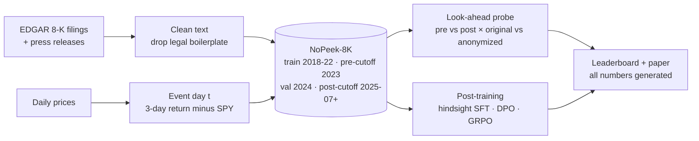

<div align="center">

# No Peeking

**Do LLMs forecast how markets react to company filings, or do they just remember what happened?**

[](https://github.com/KvnFltr/no-peeking/actions/workflows/ci.yml)
[](https://github.com/KvnFltr/no-peeking/actions/workflows/paper.yml)
[](pyproject.toml)
[](LICENSE)
[](PREREGISTRATION.md)

</div>

LLMs read company news and "predict" the stock reaction remarkably well in backtests. But their training data
contains the outcomes: a model that has read about a stock jumping after an earnings release can look like a
genius analyst. **No Peeking** is a benchmark that cannot be memorized, a one-command test of how much any model
relies on memory, and a recipe to post-train small models to reason about filings on free GPUs.


* **NoPeek-8K, a benchmark that cannot be memorized.** SEC 8-K filings (earnings, deals, executive changes) from
  S&P 500 and S&P 400 firms, each labelled with the 3-day stock return in excess of the S&P 500. The test split
  only holds filings published after every evaluated model was released, and a monthly job appends new ones.
* **A look-ahead probe for any Hugging Face model.** `nopeeking probe <model>` scores filings before and after the
  cutoff, with original and anonymized text, and estimates memorization as a difference-in-differences with
  bootstrap confidence intervals.
* **A post-training study that measures calibration, not just accuracy.** "Hindsight" rationales (a teacher sees the
  outcome and writes the reasoning an analyst could have written beforehand), SFT, DPO and GRPO with a proper-scoring
  Brier reward and a grounding reward that checks every cited number against the filing.

> Research code and data. Nothing here is financial advice.

## How it works



The probe in one line: masking names, tickers and dates removes some information in every period, but memory can
only help on filings the model may have read about. So the memorization estimate is

**DiD = (AUC pre-cutoff, original − AUC pre-cutoff, anonymized) − (AUC post-cutoff, original − AUC post-cutoff, anonymized)**

with a TF-IDF model trained on 2018-2022 as a control that cannot remember anything.

## Quickstart

```bash
git clone https://github.com/KvnFltr/no-peeking && cd no-peeking
pip install -e ".[llm]"                                      # ".[train]" for post-training

# test any model for look-ahead bias (GPU recommended; add --dtype 4bit for 7B+ on a 16 GB card)
nopeeking probe Qwen/Qwen2.5-1.5B-Instruct --config configs/v1.yaml --limit 2000
nopeeking report --config configs/v1.yaml                    # leaderboard, figure, LaTeX macros, this README
```

Build the data yourself (polite EDGAR access, about 4 hours for v1, everything cached):

```bash
echo "NOPEEKING_SEC_USER_AGENT=Your Name your@email" > .env    # SEC asks automated clients for a contact
nopeeking -v data build --config configs/v1.yaml
nopeeking baselines --config configs/v1.yaml
```

No GPU? [`notebooks/kaggle_reproduce.ipynb`](notebooks/kaggle_reproduce.ipynb) runs everything on Kaggle's free
T4s, and [`scripts/kaggle_job.py`](scripts/kaggle_job.py) drives Kaggle from your laptop.

## Results

Everything between the markers below is generated by `nopeeking report` from `results/`. No number in this README
is typed by hand, and null results are reported like any other.

<!-- RESULTS:START -->
_No results yet: run the quickstart._
<!-- RESULTS:END -->

## The dataset

| | |
|---|---|
| Source | SEC EDGAR Form 8-K (amendments excluded) and Exhibit 99.1, S&P 500 + S&P 400, 2018 to today |
| Event types | earnings (item 2.02) > deals (1.01, 2.01) > executive changes (5.02) > other (8.01) |
| Event day `t` | first session whose 16:00 ET close is after the EDGAR acceptance time |
| Target | sign of the 3-day return over sessions [t, t+2] minus SPY's; also 1-day sign and terciles |
| Splits | train 2018-22 · pre-cutoff test 2023 · validation 2024 · embargo 2025-H1 · **post-cutoff test 2025-07+** |
| Hygiene | one filing per firm-day, exact-text dedup, missing prices dropped, train-only winsorization and tercile cut-offs, every filter logged with counts |
| Shipped | filing text and derived labels; raw prices are never redistributed |

Data card: [`data/DATASET_CARD.md`](data/DATASET_CARD.md). Pre-registered analysis plan: [`PREREGISTRATION.md`](PREREGISTRATION.md).

## Leaderboard

Add your model in one pull request: see [`CONTRIBUTING.md`](CONTRIBUTING.md). The leaderboard is ranked by AUC on
the post-cutoff test, the only number memory cannot inflate, and shows each model's memorization DiD next to it.

## Repository layout

```
src/nopeeking/
  data/     EDGAR client (rate-limited, cached), universe, 8-K text, anonymization, dataset build
  labels/   prices, event days, market-adjusted returns, targets
  eval/     metrics + bootstrap, long-short portfolio, baselines, zero-shot scorer, probe, report, LaTeX
  train/    hindsight rationales + filters, rewards, SFT / DPO / GRPO (TRL + PEFT), adapter evaluation
configs/    datasets (pilot, v1, full), models, training runs
scripts/    Kaggle jobs, Hugging Face publishing, arXiv bundle
paper/      NeurIPS-style preprint; every number comes from results/*/macros.tex
```

## Limitations

* Today's index members are used for every year, so early years carry survivorship bias.
* Anonymization masks names, tickers, dates, URLs and file names, not executives or products: identity can leak,
  which makes the DiD a lower bound on recall.
* Close-to-close returns include intraday moves before filings accepted during market hours.
* Three-day reactions are noisy; read the confidence intervals, not just the point estimates.

## Citation

```bibtex
@misc{feltrin2026nopeeking,
  title  = {No Peeking: A Self-Refreshing Benchmark for Look-Ahead Bias in LLM Forecasts of Market Reactions to Corporate Filings},
  author = {Feltrin, K{\'e}vin},
  year   = {2026},
  url    = {https://github.com/KvnFltr/no-peeking}
}
```

MIT licence. Related work and full method: [`paper/`](paper/).
