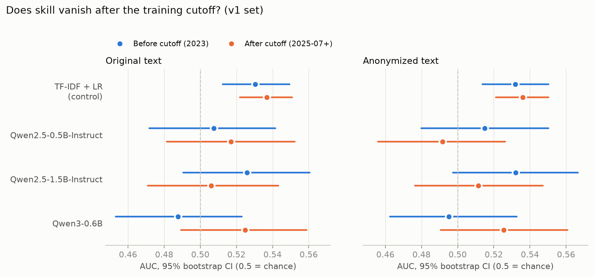
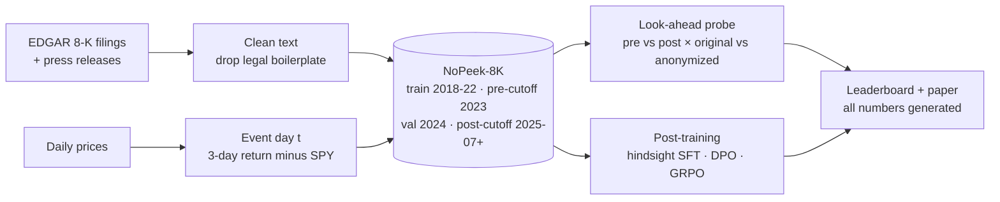

<div align="center">

# No Peeking

**Do LLMs forecast how markets react to company filings, or do they just remember what happened?**

[](https://github.com/KvnFltr/no-peeking/actions/workflows/ci.yml)
[](https://github.com/KvnFltr/no-peeking/actions/workflows/paper.yml)
[](pyproject.toml)
[](LICENSE)
[](PREREGISTRATION.md)

</div>

LLMs read company news and "predict" the stock reaction remarkably well in backtests. But their training data
contains the outcomes: a model that has read about a stock jumping after an earnings release can look like a
genius analyst. **No Peeking** is a benchmark that cannot be memorized, a one-command test of how much any model
relies on memory, and a recipe to post-train small models to reason about filings on free GPUs.



* **NoPeek-8K, a benchmark that cannot be memorized.** SEC 8-K filings (earnings, deals, executive changes) from
  S&P 500 and S&P 400 firms, each labelled with the 3-day stock return in excess of the S&P 500. The test split
  only holds filings published after every evaluated model was released, and a monthly job appends new ones.
* **A look-ahead probe for any Hugging Face model.** `nopeeking probe <model>` scores filings before and after the
  cutoff, with original and anonymized text, and estimates memorization as a difference-in-differences with
  bootstrap confidence intervals.
* **A post-training study that measures calibration, not just accuracy.** "Hindsight" rationales (a teacher sees the
  outcome and writes the reasoning an analyst could have written beforehand), SFT, DPO and GRPO with a proper-scoring
  Brier reward and a grounding reward that checks every cited number against the filing.

> Research code and data. Nothing here is financial advice.

## How it works



The probe in one line: masking names, tickers and dates removes some information in every period, but memory can
only help on filings the model may have read about. So the memorization estimate is

**DiD = (AUC pre-cutoff, original − AUC pre-cutoff, anonymized) − (AUC post-cutoff, original − AUC post-cutoff, anonymized)**

with a TF-IDF model trained on 2018-2022 as a control that cannot remember anything.

## Quickstart

```bash
git clone https://github.com/KvnFltr/no-peeking && cd no-peeking
pip install -e ".[llm]"                                      # ".[train]" for post-training

# test any model for look-ahead bias (GPU recommended; add --dtype 4bit for 7B+ on a 16 GB card)
nopeeking probe Qwen/Qwen2.5-1.5B-Instruct --config configs/v1.yaml --limit 2000
nopeeking report --config configs/v1.yaml                    # leaderboard, figure, LaTeX macros, this README
```

Build the data yourself (polite EDGAR access, about 4 hours for v1, everything cached):

```bash
echo "NOPEEKING_SEC_USER_AGENT=Your Name your@email" > .env    # SEC asks automated clients for a contact
nopeeking -v data build --config configs/v1.yaml
nopeeking baselines --config configs/v1.yaml
```

No GPU? [`notebooks/kaggle_reproduce.ipynb`](notebooks/kaggle_reproduce.ipynb) runs everything on Kaggle's free
T4s, and [`scripts/kaggle_job.py`](scripts/kaggle_job.py) drives Kaggle from your laptop.

## Results

Everything between the markers below is generated by `nopeeking report` from `results/`. No number in this README
is typed by hand, and null results are reported like any other.

<!-- RESULTS:START -->
<!-- generated by `nopeeking report --config ...`; do not edit -->

### Leaderboard: post-cutoff test

Ranked by AUC on filings published after every model's release (unseen by construction). DiD > 0 means the model does better on pre-cutoff filings only when it can see who and when: recall.

| # | model | released | params | AUC post-cutoff [95% CI] | Brier | DiD (memorization) [95% CI] |
|---:|---|---|---:|---|---|---|
| 1 | TF-IDF + LR (trained on 2018-22) |  |  | 0.537 [0.522, 0.551] | 0.250 | -0.002 [-0.007, 0.003] |
| 2 | Qwen/Qwen3-0.6B | 2025-04 | 0.6B | 0.525 [0.489, 0.559] | 0.301 | -0.007 [-0.043, 0.029] |
| 3 | Qwen/Qwen2.5-0.5B-Instruct | 2024-09 | 0.5B | 0.517 [0.482, 0.552] | 0.411 | -0.033 [-0.081, 0.011] |
| 4 | Qwen/Qwen2.5-1.5B-Instruct | 2024-09 | 1.5B | 0.506 [0.469, 0.543] | 0.448 | -0.001 [-0.030, 0.030] |

Dataset `v1`: 19783 filings, 2018-01-02 to 2026-11-23. Split sizes: train 7948, test_pre 3979, val 1992, test_post 5864.

**Filter log**

| step | before | after | note |
|---|---:|---:|---|
| universe firms (unique CIK) |  | 899 | sp500+sp400 |
| 8-K filings in date range |  | 95719 | 2018-01-01..2026-11-25 |
| event type in scope (items 2.02/1.01/2.01/5.02/8.01) | 95719 | 76113 |  |
| inside a split window | 76113 | 71764 | drops the embargo gap between val and test_post |
| prices available for full label window | 71764 | 71325 | needs close(t-1)..close(t+2); recent filings wait for their window |
| one filing per firm and event day | 71325 | 69469 | keeps highest-priority event type |
| quota sample per split | 69469 | 20000 | {"train": 8000, "test_pre": 4000, "val": 2000, "test_post": 6000} |
| filing text fetched | 20000 | 19867 | 133 fetch failures |
| text length >= 300 chars | 19867 | 19783 |  |
| dedup identical texts | 19783 | 19783 |  |

**Share of filings followed by a 3-day outperformance (y_up = 1)**: test_post 0.481, test_pre 0.499, train 0.511, val 0.468

**post-cutoff test (2025-07+)**: metric [95% bootstrap CI]

| method | n | AUC | balanced acc. | acc. | Brier | ECE | rank IC |
|---|---:|---|---|---|---|---:|---|
| majority | 5864 | 0.500 [0.500, 0.500] | 0.500 [0.500, 0.500] | 0.481 [0.469, 0.494] | 0.251 [0.250, 0.251] | 0.029 | – [–, –] |
| event_type_prior | 5864 | 0.524 [0.510, 0.538] | 0.524 [0.513, 0.533] | 0.513 [0.500, 0.525] | 0.250 [0.250, 0.251] | 0.030 | 0.042 [0.021, 0.063] |
| tfidf_lr | 5864 | 0.537 [0.522, 0.551] | 0.520 [0.508, 0.531] | 0.511 [0.498, 0.524] | 0.250 [0.249, 0.250] | 0.031 | 0.068 [0.043, 0.092] |
| tfidf_lr_anon | 5864 | 0.536 [0.521, 0.550] | 0.523 [0.511, 0.534] | 0.515 [0.501, 0.527] | 0.250 [0.249, 0.250] | 0.031 | 0.067 [0.041, 0.091] |
| Qwen/Qwen2.5-0.5B-Instruct (zero-shot) | 1000 | 0.517 [0.482, 0.552] | 0.500 [0.500, 0.500] | 0.526 [0.495, 0.558] | 0.411 [0.384, 0.437] | 0.402 | 0.032 [-0.029, 0.096] |
| Qwen/Qwen2.5-1.5B-Instruct (zero-shot) | 1000 | 0.506 [0.469, 0.543] | 0.500 [0.500, 0.500] | 0.526 [0.495, 0.558] | 0.448 [0.418, 0.476] | 0.445 | 0.011 [-0.055, 0.074] |
| Qwen/Qwen3-0.6B (zero-shot) | 1000 | 0.525 [0.489, 0.559] | 0.521 [0.496, 0.544] | 0.537 [0.506, 0.567] | 0.301 [0.285, 0.318] | 0.201 | 0.055 [-0.007, 0.117] |

**pre-cutoff test (2023)**: metric [95% bootstrap CI]

| method | n | AUC | balanced acc. | acc. | Brier | ECE | rank IC |
|---|---:|---|---|---|---|---:|---|
| majority | 3979 | 0.500 [0.500, 0.500] | 0.500 [0.500, 0.500] | 0.499 [0.484, 0.515] | 0.250 [0.250, 0.250] | 0.011 | – [–, –] |
| event_type_prior | 3979 | 0.511 [0.495, 0.529] | 0.509 [0.497, 0.522] | 0.509 [0.494, 0.524] | 0.250 [0.250, 0.250] | 0.012 | 0.024 [-0.001, 0.052] |
| tfidf_lr | 3979 | 0.530 [0.512, 0.548] | 0.514 [0.500, 0.527] | 0.513 [0.498, 0.529] | 0.249 [0.249, 0.250] | 0.012 | 0.062 [0.031, 0.092] |
| tfidf_lr_anon | 3979 | 0.532 [0.514, 0.549] | 0.512 [0.498, 0.525] | 0.511 [0.496, 0.527] | 0.249 [0.249, 0.250] | 0.011 | 0.065 [0.034, 0.095] |
| Qwen/Qwen2.5-0.5B-Instruct (zero-shot) | 1000 | 0.507 [0.470, 0.543] | 0.500 [0.500, 0.500] | 0.502 [0.471, 0.532] | 0.430 [0.404, 0.456] | 0.424 | -0.004 [-0.068, 0.056] |
| Qwen/Qwen2.5-1.5B-Instruct (zero-shot) | 1000 | 0.526 [0.490, 0.562] | 0.500 [0.500, 0.500] | 0.502 [0.471, 0.532] | 0.471 [0.442, 0.499] | 0.470 | 0.024 [-0.039, 0.085] |
| Qwen/Qwen3-0.6B (zero-shot) | 1000 | 0.488 [0.452, 0.523] | 0.489 [0.464, 0.513] | 0.490 [0.459, 0.521] | 0.322 [0.306, 0.339] | 0.239 | -0.024 [-0.085, 0.039] |

**val (2024)**: metric [95% bootstrap CI]

| method | n | AUC | balanced acc. | acc. | Brier | ECE | rank IC |
|---|---:|---|---|---|---|---:|---|
| majority | 1992 | 0.500 [0.500, 0.500] | 0.500 [0.500, 0.500] | 0.468 [0.447, 0.490] | 0.251 [0.250, 0.251] | 0.042 | – [–, –] |
| event_type_prior | 1992 | 0.502 [0.478, 0.527] | 0.513 [0.495, 0.532] | 0.496 [0.474, 0.518] | 0.251 [0.250, 0.251] | 0.042 | 0.011 [-0.026, 0.047] |
| tfidf_lr | 1992 | 0.550 [0.524, 0.575] | 0.523 [0.504, 0.542] | 0.508 [0.485, 0.530] | 0.250 [0.249, 0.251] | 0.045 | 0.073 [0.029, 0.117] |
| tfidf_lr_anon | 1992 | 0.550 [0.524, 0.575] | 0.519 [0.500, 0.538] | 0.504 [0.482, 0.526] | 0.250 [0.249, 0.251] | 0.044 | 0.073 [0.029, 0.116] |
| Qwen/Qwen2.5-0.5B-Instruct (zero-shot) | 1000 | 0.492 [0.456, 0.529] | 0.499 [0.497, 0.500] | 0.526 [0.495, 0.558] | 0.412 [0.385, 0.439] | 0.402 | -0.030 [-0.093, 0.030] |
| Qwen/Qwen2.5-1.5B-Instruct (zero-shot) | 1000 | 0.537 [0.501, 0.573] | 0.500 [0.500, 0.500] | 0.527 [0.496, 0.558] | 0.447 [0.418, 0.476] | 0.446 | 0.048 [-0.018, 0.109] |
| Qwen/Qwen3-0.6B (zero-shot) | 1000 | 0.539 [0.502, 0.575] | 0.521 [0.496, 0.545] | 0.538 [0.505, 0.569] | 0.295 [0.278, 0.311] | 0.193 | 0.048 [-0.017, 0.110] |

**Look-ahead probe (AUC)**: DiD = (pre orig - pre anon) - (post orig - post anon); > 0 suggests recall of pre-cutoff outcomes.

| model | pre orig | pre anon | post orig | post anon | pre - post (orig) | DiD |
|---|---|---|---|---|---|---|
| TF-IDF + LR (control, trained <= 2022) | 0.530 [0.513, 0.549] | 0.532 [0.514, 0.550] | 0.537 [0.522, 0.551] | 0.536 [0.521, 0.550] | -0.006 [-0.029, 0.018] | -0.002 [-0.007, 0.003] |
| Qwen/Qwen2.5-0.5B-Instruct | 0.507 [0.472, 0.541] | 0.515 [0.480, 0.550] | 0.517 [0.482, 0.552] | 0.492 [0.456, 0.526] | -0.010 [-0.060, 0.044] | -0.033 [-0.081, 0.011] |
| Qwen/Qwen2.5-1.5B-Instruct | 0.526 [0.491, 0.561] | 0.532 [0.497, 0.567] | 0.506 [0.471, 0.543] | 0.512 [0.476, 0.547] | 0.020 [-0.031, 0.071] | -0.001 [-0.030, 0.030] |
| Qwen/Qwen3-0.6B | 0.488 [0.453, 0.523] | 0.495 [0.463, 0.533] | 0.525 [0.489, 0.559] | 0.526 [0.491, 0.561] | -0.037 [-0.085, 0.015] | -0.007 [-0.043, 0.029] |

**Long-short on post-cutoff test** (top vs bottom tercile of score, cut-offs from val, 5 bps per side, market-hedged)

| method | positions | active days | ann. return | ann. vol | Sharpe [95% CI] |
|---|---:|---:|---:|---:|---|
| event_type_prior | 5864 | 353 | -0.230 | 0.164 | -1.40 [-3.15, 0.24] |
| tfidf_lr | 4032 | 353 | 0.139 | 0.233 | 0.60 [-1.17, 2.12] |
| tfidf_lr_anon | 4064 | 353 | 0.194 | 0.225 | 0.86 [-0.88, 2.36] |
| Qwen/Qwen2.5-0.5B-Instruct (zero-shot) | 658 | 336 | -0.379 | 0.355 | -1.07 [-2.74, 0.65] |
| Qwen/Qwen2.5-1.5B-Instruct (zero-shot) | 663 | 331 | -0.303 | 0.305 | -0.99 [-2.59, 0.46] |
| Qwen/Qwen3-0.6B (zero-shot) | 674 | 335 | 0.181 | 0.348 | 0.52 [-1.10, 2.08] |

<!-- RESULTS:END -->

## The dataset

| | |
|---|---|
| Source | SEC EDGAR Form 8-K (amendments excluded) and Exhibit 99.1, S&P 500 + S&P 400, 2018 to today |
| Event types | earnings (item 2.02) > deals (1.01, 2.01) > executive changes (5.02) > other (8.01) |
| Event day `t` | first session whose 16:00 ET close is after the EDGAR acceptance time |
| Target | sign of the 3-day return over sessions [t, t+2] minus SPY's; also 1-day sign and terciles |
| Splits | train 2018-22 · pre-cutoff test 2023 · validation 2024 · embargo 2025-H1 · **post-cutoff test 2025-07+** |
| Hygiene | one filing per firm-day, exact-text dedup, missing prices dropped, train-only winsorization and tercile cut-offs, every filter logged with counts |
| Shipped | filing text and derived labels; raw prices are never redistributed |

Data card: [`data/DATASET_CARD.md`](data/DATASET_CARD.md). Pre-registered analysis plan: [`PREREGISTRATION.md`](PREREGISTRATION.md).

## Leaderboard

Add your model in one pull request: see [`CONTRIBUTING.md`](CONTRIBUTING.md). The leaderboard is ranked by AUC on
the post-cutoff test, the only number memory cannot inflate, and shows each model's memorization DiD next to it.

## Repository layout

```
src/nopeeking/
  data/     EDGAR client (rate-limited, cached), universe, 8-K text, anonymization, dataset build
  labels/   prices, event days, market-adjusted returns, targets
  eval/     metrics + bootstrap, long-short portfolio, baselines, zero-shot scorer, probe, report, LaTeX
  train/    hindsight rationales + filters, rewards, SFT / DPO / GRPO (TRL + PEFT), adapter evaluation
configs/    datasets (pilot, v1, full), models, training runs
scripts/    Kaggle jobs, Hugging Face publishing, arXiv bundle
paper/      NeurIPS-style preprint; every number comes from results/*/macros.tex
```

## Limitations

* Today's index members are used for every year, so early years carry survivorship bias.
* Anonymization masks names, tickers, dates, URLs and file names, not executives or products: identity can leak,
  which makes the DiD a lower bound on recall.
* Close-to-close returns include intraday moves before filings accepted during market hours.
* Three-day reactions are noisy; read the confidence intervals, not just the point estimates.

## Citation

```bibtex
@misc{feltrin2026nopeeking,
  title  = {No Peeking: A Self-Refreshing Benchmark for Look-Ahead Bias in LLM Forecasts of Market Reactions to Corporate Filings},
  author = {Feltrin, K{\'e}vin},
  year   = {2026},
  url    = {https://github.com/KvnFltr/no-peeking}
}
```

MIT licence. Related work and full method: [`paper/`](paper/).
